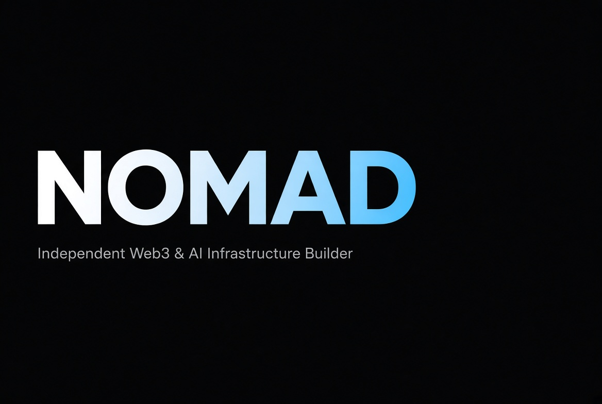

 

  

# 👋 Hi, I am Nomad

**Independent Web3 & AI Infrastructure Builder**

Building open-source products at the intersection of blockchain infrastructure, AI agents, data services and automated payments.

## 👤 About Me

I build practical tools and infrastructure for the evolving Web3 and AI ecosystems.

My work focuses on:
- Blockchain infrastructure and on-chain data
- AI agent tools and Model Context Protocol (MCP)
- ERC-8004 agent identity and discovery
- x402 and MPP machine-to-machine payments
- Open-source APIs and developer tools

## 🎯 Current Focus

- Agent-native data services and infrastructure
- AI agent discovery, identity and interoperability
- Multichain blockchain applications
- On-chain analytics and data access
- Automated payments for AI agents

## 💻 Languages

<!-- LANGUAGES:START -->
- **Solidity** 60.2%
- **TypeScript** 28.0%
- **HTML** 5.9%
- **Python** 5.0%
- **CSS** 0.8%
- **Shell** 0.1%
<!-- LANGUAGES:END -->

## 🚀 Projects

### NFT Data + NFT Data MCP

**Multichain NFT market intelligence for AI agents, available through an API, OpenSea Agent Tool and Model Context Protocol (MCP).**

[Open website](https://www.nftdata.app/) • [API repository](https://github.com/Nomad07/nft-data) • [MCP repository](https://github.com/Nomad07/nftdata-mcp) • [OpenSea Tool #778](https://opensea.io/tools/erc8257/base/778) • [McpRush](https://mcprush.com/nomad07/nftdata-mcp)

### Arc ERC-8004 Explorer

**Discover and inspect ERC-8004 agents on Arc Mainnet and Testnet through a public explorer and read-only API.**

[Open Explorer](https://arcagents.app/) • [View repository](https://github.com/Nomad07/arc-erc8004-explorer)

### Arc Agent ID

**A Python toolkit for interacting with ERC-8004 agent identity, reputation and validation registries on Arc Mainnet and Testnet.**

[View repository](https://github.com/Nomad07/arc-agent-id)

---

Building open infrastructure for the next generation of AI-powered applications.
