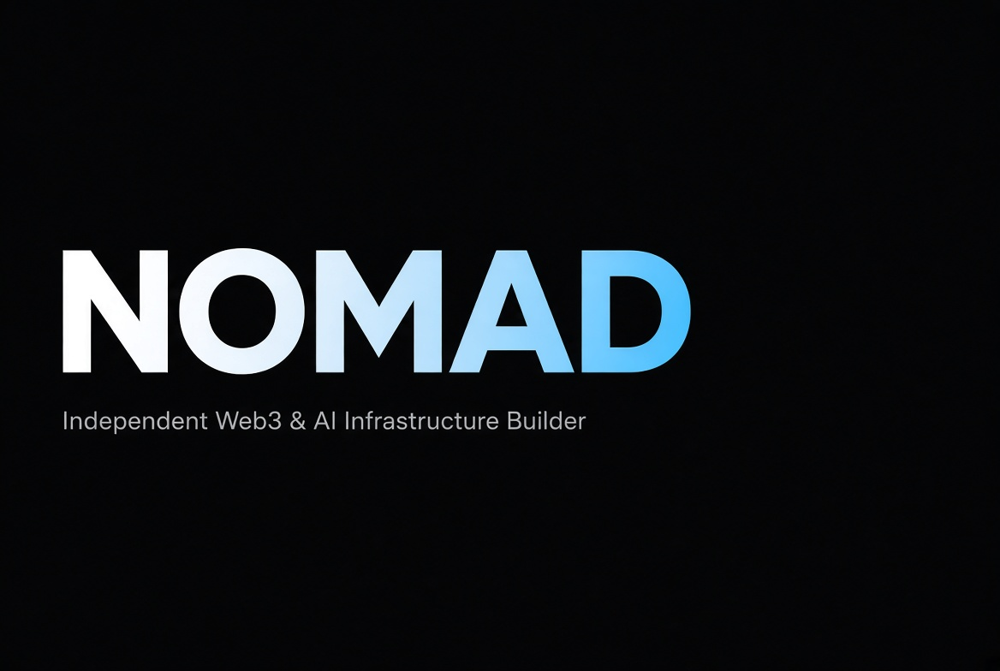

  

# 👋 Hi, I am Nomad

**Independent Web3 & AI Infrastructure Builder**

Building open-source products at the intersection of blockchain infrastructure, AI agents, data services and automated payments.

## 👤 About Me

I build practical tools and infrastructure for the evolving Web3 and AI ecosystems.

My work focuses on:

- Blockchain infrastructure and on-chain data
- AI agent tools and Model Context Protocol (MCP)
- ERC-8004 agent identity and discovery
- x402 and MPP machine-to-machine payments
- Open-source APIs and developer tools

## 🎯 Current Focus

- Agent-native data services and infrastructure
- AI agent discovery, identity and interoperability
- Multichain blockchain applications
- On-chain analytics and data access
- Automated payments for AI agents

## 💻 Languages

<!-- LANGUAGES:START -->
- **Solidity** 54.7%
- **TypeScript** 34.3%
- **HTML** 5.6%
- **Python** 4.5%
- **CSS** 0.7%
- **Shell** 0.1%
<!-- LANGUAGES:END -->

## 🚀 Projects

### NFT Data

**NFT Data is a pay-per-request multichain API for AI agents and developer tools, providing structured market data for OpenSea collections across 30 networks.**

[Open website](https://www.nftdata.app/) • [API repository](https://github.com/Nomad07/nft-data) • [OpenSea Tool #778](https://opensea.io/tools/erc8257/base/778)

### NFT Data MCP

**An open-source MCP server that gives AI assistants and agents access to multichain NFT collection and market data through the get_collection_data tool, using OpenSea API v2.**

- x402 v2 payments on Base Mainnet and Solana Mainnet.
- MPP payments on Base Mainnet.
- $0.002 USDC per successful request.
- No subscriptions or API keys.

[GitHub](https://github.com/Nomad07/nftdata-mcp) • [npm](https://www.npmjs.com/package/nftdata-mcp) • [Agent Skill](https://github.com/Nomad07/nftdata-mcp/blob/main/SKILL.md)

### Arc ERC-8004 Explorer

**Discover and inspect ERC-8004 agents on Arc Mainnet and Testnet through a public explorer and read-only API.**

[Open Explorer](https://www.arcagents.app/) • [API repository](https://github.com/Nomad07/arc-erc8004-explorer)

### Arc Agents MCP

**An open-source MCP server that brings ERC-8004 agent identity and reputation data from Arc Mainnet directly into AI assistants and autonomous agents through the get_agent_data tool.**

- x402 v2 payments on Arc Mainnet and Base Mainnet.
- $0.002 USDC per successful request.
- Agent Skill for AI coding agents, with installation and configuration instructions.
- No subscriptions or API keys.

[GitHub](https://github.com/Nomad07/arcagents-mcp) • [npm](https://www.npmjs.com/package/arcagents-mcp) • [Agent Skill](https://github.com/Nomad07/arcagents-mcp/blob/main/SKILL.md)

### Arc Agent ID

**A Python toolkit for interacting with ERC-8004 agent identity, reputation and validation registries on Arc Mainnet and Testnet.**

[View repository](https://github.com/Nomad07/arc-agent-id)

---

Building open infrastructure for the next generation of AI-powered applications.

